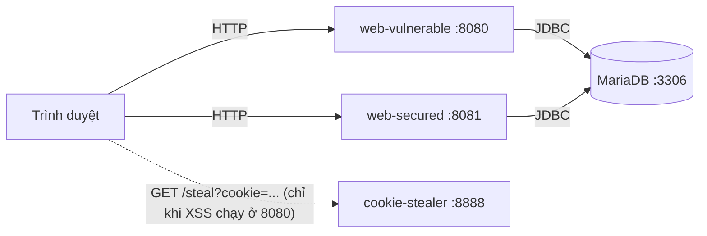

# SQL Injection và XSS trên ứng dụng thương mại điện tử giả lập (UTH E-Shop)

Đồ án môn An ninh mạng, Trường Đại học Giao thông vận tải TP.HCM (UTH). Đề tài số 3: **Khai thác lỗ hổng Web (OWASP Top 10) và giải pháp khắc phục**, tập trung vào SQL Injection và Cross-Site Scripting (XSS).

Lab gồm hai phiên bản của cùng một website bán đồ công nghệ viết bằng Java (Spring Boot, Thymeleaf), dùng chung một cơ sở dữ liệu MariaDB: **bản lỗi** ở cổng 8080 và **bản vá** ở cổng 8081. Hai bản giống nhau về giao diện và đường dẫn, chỉ khác cách viết mã, nên cùng một payload gửi vào hai bản cho hai kết quả trái ngược. Toàn bộ lab chạy cục bộ bằng Docker Compose, mọi cổng chỉ mở trên `127.0.0.1`.

## Tóm tắt kết quả

Đã chạy thử trên lab ngày 19/11/2026:

| Tấn công | Bản lỗi (8080) | Bản vá (8081) | Biện pháp khắc phục |
|---|---|---|---|
| SQLi vượt qua đăng nhập: `admin' -- ` | Vào được tài khoản admin không cần mật khẩu | "Tên đăng nhập hoặc mật khẩu không chính xác!" | Parameterized Query |
| SQLi UNION ở ô tìm kiếm | Lộ 4 tài khoản, mật khẩu, số thẻ | "Không tìm thấy sản phẩm nào" | Parameterized Query |
| Reflected XSS qua ô tìm kiếm | Mã chạy, đọc được cookie phiên | Hiện nguyên văn thành chữ | Output Encoding (`th:text`) |
| Stored XSS qua bình luận, chiếm phiên | Cookie admin bị gửi về cổng 8888, vào được tài khoản admin | Bình luận hiện nguyên văn, không gửi được cookie | Output Encoding, HttpOnly, SameSite, CSP |

Kiểm thử tự động `mvn test`: bản lỗi đạt 36/36 ca, bản vá đạt 39/39 ca (lần chạy ngày 19/11/2026).

## 1. Mô hình demo



| Thành phần | Công nghệ | Cổng | Vai trò |
|---|---|---|---|
| `web-vulnerable` | Spring Boot 3.2.5, Java 17, Thymeleaf, JDBC | 8080 | Bản lỗi, mục tiêu tấn công |
| `web-secured` | Như trên, thêm `SecurityHeadersFilter` | 8081 | Bản vá, dùng để đối chứng |
| `db` | MariaDB 10.5 | 3306 (chỉ trong mạng Docker) | CSDL `ecommerce_db` dùng chung |
| `cookie-stealer` | Python 3.9 | 8888 | Máy chủ của kẻ tấn công, ghi lại cookie bị trộm; chỉ bật khi demo XSS |

Lỗ hổng ở bản 8080 là **cố ý**. Không vá bản 8080; mọi bản vá chỉ làm trong `lab-environment/app-secured/`.

## 2. Chuẩn bị

Công cụ cần có:

- Docker Desktop (Docker Compose v2 trở lên).
- Trình duyệt Chrome hoặc Edge, dùng DevTools (F12) để xem và sửa cookie khi demo chiếm phiên.
- Chỉ khi chạy không dùng Docker hoặc chạy kiểm thử: JDK 17 trở lên, Apache Maven 3.9 trở lên.
- Python 3.9 trở lên để chạy các script `scripts/verify_*.py`.

Cấu hình qua biến môi trường (xem `.env.example`):

| Biến | Ý nghĩa | Mặc định |
|---|---|---|
| `SERVER_PORT` | Cổng HTTP của ứng dụng | `8080` (bản lỗi), `8081` (bản vá) |
| `DB_HOST` | Địa chỉ CSDL | `db` trong Docker, `localhost` khi chạy trực tiếp |
| `DB_PORT` | Cổng CSDL | `3306` |
| `DB_NAME` | Tên CSDL | `ecommerce_db` |
| `DB_USER`, `DB_PASS` | Tài khoản CSDL của lab | `db_user`, `P@ssword123` |

Toàn bộ tài khoản, mật khẩu và số thẻ trong lab là dữ liệu giả.

## 3. Triển khai

### Cách 1: Docker Compose (khuyến nghị)

```powershell
# 1. Khởi động lab kèm máy chủ hứng cookie (cổng 8888)
docker compose --profile xss-demo up -d --build

# 2. Đưa CSDL về dữ liệu ban đầu (xóa bình luận độc hại của lần demo trước)
.\scripts\reset_db.ps1

# 3. Kiểm tra bốn container đã chạy
docker compose ps
```

Trên Linux hoặc macOS dùng `scripts/reset_db.sh` thay cho `reset_db.ps1`. Sau khi sửa mã Java hoặc template, dựng lại container, ví dụ `docker compose up -d --build web-secured`; container không tự cập nhật theo mã nguồn.

Địa chỉ truy cập:

- Bản lỗi: http://localhost:8080
- Bản vá: http://localhost:8081
- Máy chủ hứng cookie: http://localhost:8888 (chỉ khi bật profile `xss-demo`)

### Cách 2: Maven trực tiếp, không cần Docker

```bash
cd lab-environment/app-vulnerable
mvn spring-boot:run

# Cửa sổ terminal thứ hai
cd lab-environment/app-secured
mvn spring-boot:run
```

Theo mã nguồn (`DbConfig`), nếu không kết nối được MariaDB, ứng dụng tự chuyển sang CSDL H2 trong bộ nhớ và nạp lại `lab-environment/db/init.sql`.

### HTTPS cho bản vá (tùy chọn)

`docker-compose.tls.yml` bổ sung cấu hình HTTPS cho `web-secured` ở cổng 8443 và bật cờ `Secure` cho cookie phiên. Script `scripts/verify_tls_cookie_secure.py` kiểm tra cấu hình này.

## 4. Demo trực tiếp (khoảng 15 phút)

Chi tiết từng bước, lời thuyết minh và câu hỏi thường gặp nằm trong [kịch bản demo](docs/bao_cao/kich_ban_demo_sqli_xss.md). Tóm tắt:

**Màn 1: SQLi vượt qua đăng nhập.** Ở `/login` của 8080, nhập tên đăng nhập `admin' -- ` (có dấu cách ở cuối) và mật khẩu bất kỳ. Dấu `'` đóng chuỗi sớm, `-- ` chú thích phần kiểm tra mật khẩu, nên đăng nhập thành công vào admin.

**Màn 2: SQLi trích xuất dữ liệu.** Ở `/search` của 8080, nhập `'` để thấy lỗi MySQL, rồi nhập:

```
zzz' UNION SELECT 1, username, password, credit_card FROM users -- 
```

Danh sách "sản phẩm" trả về là bảng `users` kèm mật khẩu và số thẻ.

**Màn 3: XSS chiếm phiên.** Chia hai vai: cửa sổ ẩn danh là kẻ tấn công (không biết mật khẩu), cửa sổ thường là admin.

1. Kẻ tấn công dò ô tìm kiếm bằng `<b>test</b>` rồi `<script>alert(document.cookie)</script>`.
2. Kẻ tấn công gửi bình luận chứa mã trộm cookie vào `/product?id=1` (không cần đăng nhập).
3. Admin đăng nhập bằng mật khẩu thật, mở trang sản phẩm đó.
4. Theo dõi cookie bị trộm: `docker logs -f --tail 0 websec_cookie_stealer`.
5. Kẻ tấn công dán `session_token` vừa nhận vào F12 → Application → Cookies, tải lại trang và vào được tài khoản admin.

**Đối chứng ở 8081.** Chạy lại đúng các payload trên cổng 8081: tất cả bị chặn. Sau buổi demo chạy lại `scripts/reset_db.ps1`.

Các payload mẫu nằm trong `exploits/sqli/` và `exploits/xss/`.

## 5. Khác biệt giữa hai phiên bản

| Tiêu chí | Bản lỗi (`app-vulnerable`, 8080) | Bản vá (`app-secured`, 8081) |
|---|---|---|
| Truy vấn SQL | Nối chuỗi, dùng `Statement` | `PreparedStatement` với tham số `?` |
| Hiển thị dữ liệu người dùng | `th:utext` (không mã hóa) | `th:text` (mã hóa HTML) |
| Cookie phiên | `session_token`, `HttpOnly=false`, token là Base64 của tên đăng nhập ghép hậu tố cố định | `SECUREDSESSION`, `HttpOnly`, `SameSite=Strict`; `SESSION_COOKIE_SECURE=true` khi chạy HTTPS |
| Header bảo mật | Không có | `SecurityHeadersFilter`: CSP, X-Frame-Options, nosniff, Referrer-Policy, Permissions-Policy |
| Thông báo lỗi CSDL | Hiện nguyên văn lên trang | Chỉ ghi log, trang lỗi không lộ chi tiết |
| Đầu vào | Nhận chuỗi thô | Chặn ký tự điều khiển, giới hạn độ dài bình luận, chuẩn hóa địa chỉ chuyển hướng |

## 6. Cấu trúc thư mục

```text
├── README.md
├── docker-compose.yml          # Lab Docker: db, web-vulnerable, web-secured, cookie-stealer (profile xss-demo)
├── docker-compose.tls.yml      # Bổ sung HTTPS cho bản vá (tùy chọn)
├── .env.example                # Mẫu biến môi trường
│
├── lab-environment/
│   ├── db/init.sql             # Lược đồ và dữ liệu mẫu
│   ├── app-vulnerable/         # Spring Boot bản lỗi (8080)
│   └── app-secured/            # Spring Boot bản vá (8081), thêm gói filter
│
├── exploits/
│   ├── sqli/                   # Payload bypass đăng nhập, payload UNION, script sqlmap
│   └── xss/                    # Payload XSS, máy chủ hứng cookie
│
├── scripts/                    # reset_db.ps1 / reset_db.sh, các script verify_*.py
└── docs/
    ├── bao_cao/                # Báo cáo Word, kịch bản demo, tài liệu trình bày
    ├── slides/                 # Hướng dẫn làm slide
    └── tasks/                  # Hồ sơ nghiệm thu từng task
```

## 7. Tài liệu

- [Kịch bản demo SQL Injection và XSS](docs/bao_cao/kich_ban_demo_sqli_xss.md): các bước, lời thuyết minh, câu hỏi thường gặp.
- [Cách trình bày phần SQL Injection](docs/bao_cao/cach_trinh_bay_sql_injection.md): hỏi đáp riêng cho màn đăng nhập.
- [Báo cáo theo mẫu Nhóm 44](docs/bao_cao/bao_cao_sqli_xss_theo_mau.docx): bản Word đầy đủ.
- [Thuyết minh thiết kế](docs/bao_cao/thuyet_minh_thiet_ke_websec.docx): kiến trúc, lược đồ lớp, cơ sở dữ liệu.
- [Đề cương báo cáo](docs/bao_cao/DE_CUONG_BAO_CAO_CHI_TIET_UTH.md) và [hướng dẫn làm slide](docs/slides/HUONG_DAN_LAM_SLIDE_UTH.md).
- [Hồ sơ nghiệm thu từng task](docs/tasks/), kèm log bằng chứng trong `docs/tasks/logs/`.

## 8. Kiểm tra và giới hạn

Chạy kiểm thử của từng ứng dụng:

```bash
cd lab-environment/app-vulnerable && mvn test
cd lab-environment/app-secured && mvn test
```

Bản lỗi có bộ kiểm thử khẳng định lỗ hổng vẫn khai thác được; bản vá có bộ kiểm thử khẳng định cùng payload bị chặn. Các script `scripts/verify_*.py` gửi yêu cầu HTTP thật tới lab đang chạy và ghi bằng chứng vào `docs/tasks/logs/`.

Giới hạn:

- Mật khẩu vẫn lưu dạng chữ thường ở cả hai bản để màn UNION thấy rõ hậu quả; hệ thống thật phải băm bằng bcrypt hoặc Argon2.
- Chưa có CSRF token, giới hạn số lần đăng nhập sai, tài khoản CSDL quyền tối thiểu.
- Phạm vi dừng ở SQLi dạng In-band và XSS dạng Reflected, Stored; chưa demo Blind SQLi và DOM-based XSS.
- Hộp thoại `alert` của Reflected XSS chưa được kiểm chứng trên Chrome thật; script `exploits/sqli/run_sqlmap_demo.sh` chưa được chạy thử.

## 9. Phân công công việc nhóm

| Thành viên | Vai trò | Nhiệm vụ chính |
|---|---|---|
| Thành viên 1 | Trưởng nhóm, Lab Lead | Quản lý repo, dựng Docker, demo SQL Injection |
| Thành viên 2 | Security Engineer | Demo XSS, triển khai mã vá và cấu hình bảo mật |
| Thành viên 3 | Tài liệu và báo cáo | Viết báo cáo Word theo mẫu của trường |
| Thành viên 4 | Slide và thuyết trình | Soạn slide 25 đến 40 trang, quay video demo dự phòng |

## 10. Cảnh báo pháp lý và đạo đức

Mọi kịch bản và mã tấn công trong dự án chỉ được thực thi trong môi trường lab cục bộ phục vụ học tập và nghiên cứu tại UTH. Payload chỉ gửi tới `localhost:8080` và `localhost:8081`. Nghiêm cấm thử nghiệm trên hệ thống bên ngoài khi chưa được phép.
