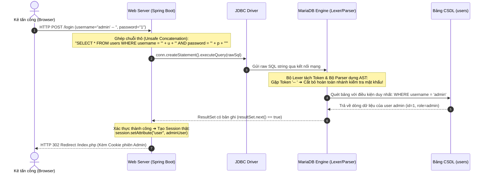

# KỊCH BẢN CHI TIẾT DEMO VÀ THUYẾT TRÌNH SQL INJECTION (AUTH BYPASS)
## Môn học: An toàn mạng & An ninh ứng dụng Web - UTH E-Shop Lab

---

## 🎯 MỤC TIÊU DEMO
1. **Làm rõ bản chất lỗ hổng (Vulnerable - Port 8080):** Kẻ tấn công bẻ gãy logic xác thực như thế nào chỉ bằng đầu vào ở ô tài khoản, qua mặt khâu kiểm tra mật khẩu, hệ thống tạo phiên `admin` và chuyển hướng về trang chủ.
2. **Làm rõ cơ chế khắc phục triệt để (Secured - Port 8081):** `PreparedStatement` (Parameterized Query) hoạt động ra sao, tại sao cùng một chuỗi tấn công đó lại bị vô hiệu hóa hoàn toàn thành dữ liệu thuần túy (literal string) mà không làm thay đổi cấu trúc câu lệnh SQL.
3. **Đối chiếu trực quan và thuyết phục:** Có hình ảnh, câu lệnh SQL thực thi, trạng thái phiên đăng nhập (session), và thông báo trên giao diện để thầy cô kiểm chứng ngay lập tức.

---

## 🖥️ CHUẨN BỊ MÔI TRƯỜNG & ĐỊA CHỈ TRUY CẬP
- **Ứng dụng tồn tại lỗ hổng (Vulnerable):** [http://localhost:8080/login](http://localhost:8080/login)
- **Ứng dụng đã được khắc phục bảo mật (Secured):** [http://localhost:8081/login](http://localhost:8081/login)
- **Cơ sở dữ liệu lab:** MariaDB 10.5 (Dữ liệu giả lập cô lập, không chứa thông tin thực).

---

## PHẦN 1: DEMO LỖ HỔNG SQL INJECTION (ỨNG DỤNG LỖ HỔNG - CỔNG 8080)

### 📌 Bước 1: Mở màn hình đăng nhập bản lỗi
- Mở trình duyệt truy cập: `http://localhost:8080/login`.
- Giao diện có tiêu đề màu đỏ: **"Đăng nhập khách hàng - Hệ thống TMĐT Lab Nghiên cứu An ninh mạng UTH"**.
- Nếu đang có phiên đăng nhập cũ, bấm **Đăng xuất** để đưa về trạng thái khách vãng lai.

### 📌 Bước 2: Nhập thông tin thử nghiệm & Quan sát giao diện
- **Tên đăng nhập:** Nhập `admin' -- ` *(Lưu ý: Có dấu nháy đơn `'`, 2 dấu gạch ngang `--` và 1 dấu khoảng trắng ở cuối)*.
  *(Hoặc bấm nút vàng **"Điền mẫu SQLi vào form"** ở khung bên dưới để tự động điền)*.
- **Mật khẩu:** Nhập bất kỳ chuỗi ngẫu nhiên nào, ví dụ: `1` hoặc `sai_mat_khau_123`.
- **Thao tác phụ:** Bấm vào **icon con mắt** bên phải ô mật khẩu để chuyển đổi hiển thị:
  - Khi mật khẩu đang ẩn: Icon con mắt mở.
  - Khi bấm hiển thị mật khẩu dạng văn bản rõ: Icon con mắt có dấu gạch chéo.
  - Khi ô mật khẩu trống: Icon tự động ẩn.

### 📌 Bước 3: Chỉ cho thầy cô xem "Khung xem trước câu lệnh SQL thực thi" (Live SQL Preview)
Ngay dưới form đăng nhập, khung màu đen viền đỏ mô phỏng chính xác cách mã nguồn backend xử lý:
```sql
SELECT * FROM users WHERE username = 'admin' -- ' AND password = 'sai_mat_khau_123'
```
- **Chỉ rõ điểm bất thường trên màn hình:**
  1. Dấu nháy đơn `'` trong `admin'` đã **đóng chuỗi** `username` sớm hơn dự kiến.
  2. Ký tự `-- ` (kèm khoảng trắng phía sau) trong chuẩn SQL của MariaDB/MySQL là cú pháp **bắt đầu một chú thích (comment)**.
  3. Toàn bộ phần phía sau gồm `' AND password = 'sai_mat_khau_123'` bị biến thành comment, hiển thị **gạch ngang màu xám (strikethrough)**.
  4. Trạng thái cảnh báo: `⚠️ Nguy hiểm: Dấu nháy đơn đã ngắt chuỗi và -- đã biến điều kiện kiểm tra mật khẩu thành chú thích!`

### 📌 Bước 4: Bấm Đăng nhập và chứng minh kết quả
- Bấm nút **"ĐĂNG NHẬP"** màu đỏ (hoặc bấm nút đỏ **"▶ Chạy thử ca SQLi ngay"**).
- **Kết quả thực tế diễn ra trên màn hình:**
  1. Trình duyệt **chuyển hướng ngay về trang chủ** (`http://localhost:8080/index.php` hoặc `http://localhost:8080/`).
  2. Xuất hiện **Banner cảnh báo màu đỏ** nổi bật trên đầu trang:
     > `⚠️ SQL Injection Auth Bypass thành công! Bạn đã đăng nhập với tư cách admin mà không cần mật khẩu chính xác.`
     > `Câu truy vấn thực tế backend đã chạy: SELECT * FROM users WHERE username = 'admin' -- ' AND password = '...'`
  3. Nhìn lên góc phải thanh điều hướng (Navbar): Hiển thị `Xin chào, Quản trị viên hệ thống (admin)` cùng nút `Đăng xuất`.
  4. **Ý nghĩa:** Kẻ tấn công không cần biết mật khẩu của quản trị viên nhưng đã chiếm toàn quyền điều khiển hệ thống TMĐT.

---

## 🔬 MÔ PHỎNG CHI TIẾT 5 GIAI ĐOẠN QUÁ TRÌNH SQL INJECTION DIỄN RA (HẬU TRƯỜNG)



### 1. Giai đoạn 1: Trình duyệt gửi gói tin (Client Request)
- Kẻ tấn công nhập vào form và bấm Đăng nhập. Trình duyệt đóng gói HTTP POST gửi lên `/login`:
  ```http
  POST /login HTTP/1.1
  Host: localhost:8080
  Content-Type: application/x-www-form-urlencoded

  username=admin%27%20--%20&password=1
  ```

### 2. Giai đoạn 2: Máy chủ Backend ghép chuỗi động (Unsafe String Concatenation)
- Tại `AppController.java`, mã nguồn xử lý bằng cách cộng chuỗi trực tiếp:
  ```java
  String sql = "SELECT * FROM users WHERE username = '" + username + "' AND password = '" + password + "'";
  ```
- Chuỗi kết quả sinh ra trong bộ nhớ RAM của Spring Boot:
  ```sql
  SELECT * FROM users WHERE username = 'admin' -- ' AND password = '1'
  ```
- Backend dùng `Statement.executeQuery(sql)` gửi nguyên văn chuỗi này qua kết nối TCP tới MariaDB.

### 3. Giai đoạn 3: Phân tích từ vựng CSDL (Lexer / Tokenizer)
- MariaDB tiếp nhận chuỗi và bộ phân tích từ vựng (Lexer) bóc tách thành một danh sách các **Token**:
  - Token 1: `KEYWORD(SELECT)`
  - Token 2: `WILDCARD(*)`
  - Token 3: `KEYWORD(FROM)`
  - Token 4: `IDENTIFIER(users)`
  - Token 5: `KEYWORD(WHERE)`
  - Token 6: `IDENTIFIER(username)`
  - Token 7: `OPERATOR(=)`
  - Token 8: `LITERAL_STRING('admin')`  *(do dấu nháy đơn `'` đã đóng chuỗi tại đây)*
  - Token 9: `COMMENT_START(-- )`  *(hai dấu gạch ngang và dấu cách kích hoạt chế độ comment dòng)*
  - Các ký tự còn lại: `' AND password = '1'` bị Lexer xếp vào nội dung comment và **vứt bỏ khỏi luồng token**.

### 4. Giai đoạn 4: Dựng Cây cú pháp trừu tượng (AST - Abstract Syntax Tree)
- Bộ phân tích cú pháp (Parser) nhận luồng token đã bị cắt cụt và xây dựng cây cú pháp thực thi:
  ```
  [Bình thường khi không bị tấn công]:
                 [SELECT * FROM users]
                           |
                        [WHERE]
                           |
                        [ AND ]
                       /       \
         [username = '...']   [password = '...']

  [Khi bị SQL Injection với "admin' -- "]:
                 [SELECT * FROM users]
                           |
                        [WHERE]
                           |
                 [username = 'admin']
               (Toàn bộ nhánh AND password đã BỊ CẮT BỎ!)
  ```
- **Ý nghĩa then chốt:** Cơ chế bảo vệ mật khẩu của ứng dụng không hề chạy, vì trong cây cú pháp của CSDL hoàn toàn **không tồn tại** điều kiện kiểm tra mật khẩu nữa!

### 5. Giai đoạn 5: Thực thi & Cấp phiên quản trị (Execution & Session Hijacking)
- **Execution Engine** của CSDL chạy cây AST: Quét chỉ mục hoặc bảng `users`, tìm thấy dòng `username = 'admin'`.
- CSDL trả về một `ResultSet` chứa dòng thông tin quản trị viên: `id = 1, username = 'admin', full_name = 'Quản trị viên hệ thống', role = 'admin'`.
- Backend Java nhận kết quả:
  ```java
  if (rs.next()) {
      User user = new User(rs.getInt("id"), rs.getString("username"), rs.getString("role"), ...);
      session.setAttribute("user", user); // Tạo session đăng nhập thật
      return "redirect:/"; // Chuyển về trang chủ
  }
  ```
- Trình duyệt nhận phản hồi HTTP 302, tự động tải `/index.php` với Cookie phiên làm việc mới, chính thức hoàn tất cuộc tấn công.

---

## PHẦN 2: DEMO CÁCH KHẮC PHỤC BẢO MẬT (ỨNG DỤNG AN TOÀN - CỔNG 8081)

### 📌 Bước 1: Mở màn hình đăng nhập bản bảo mật
- Mở một tab mới truy cập: `http://localhost:8081/login`.
- Giao diện có huy hiệu khiên bảo vệ màu xanh lam: **"Đăng nhập bảo mật - Hệ thống TMĐT Lab Nghiên cứu An ninh mạng UTH"**.

### 📌 Bước 2: Dùng lại CHÍNH XÁC payload tấn công vừa khai thác ở 8080
- **Tên đăng nhập:** Nhập `admin' -- `
- **Mật khẩu:** Nhập `sai_mat_khau_123`
  *(Hoặc bấm nút **"Điền mẫu SQLi vào form"** ở khung Đối chứng màu xanh lam)*.

### 📌 Bước 3: Phân tích cơ chế bảo vệ với khung PreparedStatement
Ngay dưới form có khung viền xanh lam hiển thị cơ chế `PreparedStatement`:
```sql
PreparedStatement: SELECT * FROM users WHERE username = ? AND password = ?
  -> Tham số ?1 (username): "admin' -- "
  -> Tham số ?2 (password): "sai_mat_khau_123"
```
- **Giải thích cho thầy cô:**
  1. Cấu trúc câu lệnh SQL đã được máy chủ gửi tới CSDL để biên dịch trước (compile) với 2 vị trí giữ chỗ tham số `?`.
  2. CSDL hiểu cố định rằng: Câu truy vấn này BẮT BUỘC phải thỏa mãn cả 2 điều kiện: cột `username` bằng tham số 1 VÀ cột `password` bằng tham số 2.
  3. Giá trị `admin' -- ` được truyền qua giao thức nhị phân như một **dữ liệu thuần túy (literal value)**.
  4. CSDL **KHÔNG** phân tích cú pháp ký tự `'` hay `-- ` trong tham số, do đó logic của câu lệnh không thể bị thay đổi hay bị vô hiệu hóa.

### 📌 Bước 4: Bấm Đăng nhập và quan sát phản ứng của hệ thống
- Bấm nút **"ĐĂNG NHẬP"** màu xanh lam (hoặc nút **"▶ Chạy thử ca SQLi ngay"**).
- **Kết quả thực tế:**
  1. Ứng dụng **từ chối đăng nhập**, giữ nguyên người dùng tại trang `http://localhost:8081/login`.
  2. Xuất hiện hộp thông báo màu đỏ cam: `⚠️ Tên đăng nhập hoặc mật khẩu không chính xác!`.
  3. Hoàn toàn **KHÔNG tạo phiên** (Navbar vẫn ở trạng thái Khách vãng lai, có nút Đăng nhập).
  4. **Giải thích:** CSDL đi tìm xem trong bảng `users` có ai mang username đúng bằng chuỗi `admin' -- ` (11 ký tự) hay không. Do không có user nào tên như vậy, kết quả trả về rỗng -> Hệ thống xác thực thất bại một cách an toàn.

### 📌 Bước 5: Kiểm chứng tính toàn vẹn (Hệ thống không bị ảnh hưởng nghiệp vụ thường)
- Kéo xuống bảng tài khoản mẫu (Seed Data) ở cuối trang 8081.
- Bấm nút **"Điền"** ở dòng tài khoản `admin` (Mật khẩu: `admin123_super_secret`).
- Bấm **"ĐĂNG NHẬP"**:
  - Đăng nhập thành công, chuyển về trang chủ an toàn với đầy đủ phiên làm việc của `admin`.
  - Chứng minh: Giải pháp `PreparedStatement` vừa chặn đứng 100% tấn công SQLi, vừa đảm bảo chức năng đăng nhập hợp lệ hoạt động hoàn hảo.

---

## 📊 BẢNG TỔNG HỢP SO SÁNH ĐỐI CHỨNG (DÙNG TRÌNH CHIẾU TRÊN BÁO CÁO / SLIDE)

| Tiêu chí đối chứng | Bản tồn tại lỗ hổng (Port 8080) | Bản đã khắc phục (Port 8081) |
| :--- | :--- | :--- |
| **Kỹ thuật xử lý SQL** | Nối chuỗi động (`Statement` / String concat) | Truy vấn tham số hóa (`PreparedStatement`) |
| **Mẫu câu lệnh Backend** | `"SELECT * FROM users WHERE username = '" + u + "' AND password = '" + p + "'"` | `"SELECT * FROM users WHERE username = ? AND password = ?"` |
| **Cách xử lý ký tự `'` và `-- `** | Trở thành mã lệnh SQL thực thi, đóng chuỗi và chú thích bỏ qua mật khẩu | Trở thành chuỗi ký tự giá trị thuần túy (string literal), không có quyền thực thi |
| **Kết quả khi nhập `admin' -- `** | **Bypass thành công:** Tạo phiên `admin`, redirect về `/index.php` | **Bị chặn hoàn toàn:** Báo lỗi sai tài khoản, không tạo phiên |
| **Tiêu chuẩn tuân thủ** | Vi phạm OWASP Top 10 A03:2021 - Injection | Đạt chuẩn phòng chống OWASP Cheat Sheet & NIST SP 800-53 |

---

## 🎙️ LỜI THOẠI THUYẾT TRÌNH MẪU (ĐỌC CHO THẦY CÔ NGHE TRONG 2 PHÚT)

> *"Kính thưa Thầy/Cô và các bạn,*
>
> *Sau đây nhóm em xin phép demo ca kiểm thử lỗ hổng SQL Injection (Authentication Bypass) và phương pháp khắc phục trên hệ thống thương mại điện tử UTH E-Shop Lab.*
>
> *Trước hết, tại ứng dụng bản lỗi cổng 8080, em thực hiện đăng nhập với tư cách kẻ tấn công. Trong ô Tên đăng nhập, em nhập payload `admin' -- ` và mật khẩu gõ tùy ý là `1`. Khi em bấm vào biểu tượng con mắt để xem lại, mật khẩu hiển thị rõ ràng.*
>
> *Như Thầy có thể quan sát trực quan ngay tại khung màu đen mô phỏng bên dưới: Do mã nguồn ở bản 8080 sử dụng kỹ thuật ghép chuỗi trực tiếp, ký tự nháy đơn `'` đã đóng chuỗi username sớm, và hai dấu gạch ngang `-- ` đã biến toàn bộ vế kiểm tra mật khẩu phía sau thành một đoạn chú thích (comment) – được đánh dấu gạch ngang mờ.*
>
> *Bây giờ, em bấm nút **Đăng nhập**. Ngay lập tức, hệ thống bỏ qua bước kiểm tra mật khẩu, máy chủ tìm thấy bản ghi của `admin`, cấp phiên đăng nhập thật và chuyển hướng về trang chủ `/index.php`. Banner cảnh báo màu đỏ trên màn hình cùng thông tin tài khoản admin trên thanh menu xác nhận rằng cuộc tấn công bypass đã thành công trọn vẹn.*
>
> *Tiếp theo, em chuyển sang ứng dụng bản an toàn tại cổng 8081 để kiểm chứng phương pháp khắc phục. Tại đây, em nhập lại chính xác payload tấn công vừa rồi là `admin' -- ` và mật khẩu sai.*
>
> *Ở bản 8081, nhóm em đã áp dụng giải pháp chuẩn là `PreparedStatement` với truy vấn tham số hóa. Cấu trúc câu lệnh SQL `WHERE username = ? AND password = ?` được tách rời hoàn toàn khỏi dữ liệu người dùng. Dữ liệu `admin' -- ` chỉ được xem là một chuỗi ký tự tìm kiếm thuần túy trong cột username.*
>
> *Khi em bấm **Đăng nhập**, máy chủ tìm kiếm người dùng có tên chính xác là `admin' -- `, kết quả trả về rỗng, và ứng dụng lập tức từ chối đăng nhập với thông báo màu đỏ cam, phiên làm việc hoàn toàn không được tạo.*
>
> *Để chứng minh bản vá không làm ảnh hưởng đến luồng hoạt động bình thường, em bấm điền tài khoản hợp lệ của `admin` với mật khẩu chính xác. Lúc này, hệ thống xác thực thành công và đăng nhập bình thường.*
>
> *Qua đó chứng minh phương pháp PreparedStatement đã triệt tiêu hoàn toàn nguy cơ SQL Injection theo đúng khuyến nghị của OWASP. Em xin cảm ơn Thầy/Cô đã lắng nghe!"*

---

## ❓ CÂU HỎI THẦY CÔ HAY HỎI VÀ CÁCH TRẢ LỜI ĐẠT ĐIỂM TỐI ĐA

### Câu hỏi 1: Tại sao sau dấu `--` lại bắt buộc phải có khoảng trắng (space)?
**Trả lời:**
> *"Thưa thầy, theo tiêu chuẩn SQL của MySQL/MariaDB, cú pháp chú thích dòng `--` bắt buộc phải theo sau bởi ít nhất một khoảng trắng (space) hoặc ký tự điều khiển (tab, newline). Nếu không có khoảng trắng, trình biên dịch SQL sẽ hiểu nhầm đó là toán tử trừ hai lần `--` và gây lỗi cú pháp (Syntax Error)."*

### Câu hỏi 2: Ngoài `PreparedStatement`, còn có cách nào khác để phòng chống SQL Injection không?
**Trả lời:**
> *"Thưa thầy, `PreparedStatement` là tuyến phòng thủ bắt buộc và quan trọng nhất (Primary Defense). Ngoài ra, theo tiêu chuẩn Defense-in-Depth (Phòng thủ nhiều lớp), nhóm kết hợp thêm: (1) Sử dụng ORM như Hibernate/JPA có cơ chế mapping an toàn, (2) Kiểm tra hợp lệ dữ liệu đầu vào (Input Validation & Whitelisting) chỉ cho phép ký tự chữ và số đối với username, (3) Phân quyền tài khoản cơ sở dữ liệu ở mức tối thiểu (Principle of Least Privilege), không dùng user `root` để chạy ứng dụng."*

### Câu hỏi 3: Phiên `admin` sau khi bypass có thao tác được các tính năng quản trị khác không?
**Trả lời:**
> *"Thưa thầy, có. Vì cơ chế phiên của Spring Boot lưu đối tượng người dùng vào `HttpSession`. Khi câu lệnh SQL trả về bản ghi của user `admin` từ bảng CSDL, ứng dụng đã đọc đầy đủ thông tin: họ tên, email và quyền `role = admin` để nạp vào phiên làm việc. Do đó, kẻ tấn công sau khi bypass sẽ sở hữu đầy đủ quyền hạn của Quản trị viên trên hệ sinh thái."*
