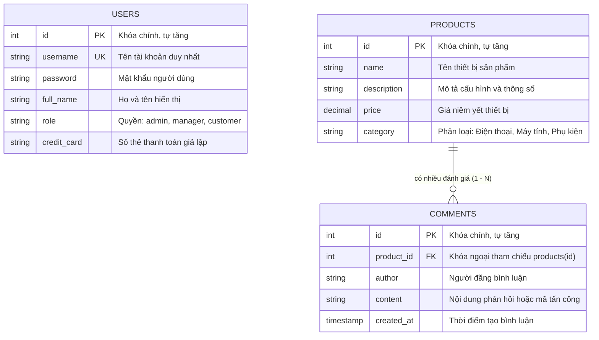

# Hồ sơ công việc và biên bản nghiệm thu CORE-03

## 1. Thông tin công việc

| Thuộc tính | Nội dung chi tiết |
|---|---|
| **Mã nội bộ** | `CORE-03` |
| **Mã trên Jira** | `ANM-19` |
| **Tên công việc** | Thiết kế các lớp User, Product, Comment thống nhất với dữ liệu dùng trong hai ứng dụng |
| **Phụ trách** | `TV3` - Trần Văn Ngọc Thắng (trưởng nhóm: Ngọc Thắng) |
| **Mức ưu tiên** | Cao |
| **Mục tiêu** | Thiết kế và chuẩn hóa các lớp thực thể dữ liệu User, Product, Comment thống nhất với lược đồ cơ sở dữ liệu mẫu giữa hai ứng dụng |
| **Sản phẩm bàn giao** | Ba lớp mô hình dữ liệu (`User.java`, `Product.java`, `Comment.java`) trong mỗi ứng dụng, sơ đồ quan hệ thực thể, bộ kiểm thử đơn vị (`ModelMappingTest.java`) và tài liệu nghiệm thu |
| **Tiêu chí hoàn thành** | Ánh xạ rõ tên trường, kiểu dữ liệu, khóa và quan hệ với lược đồ; hai ứng dụng sử dụng cùng ý nghĩa dữ liệu; các luồng đọc dữ liệu người dùng, sản phẩm, bình luận tạo được mô hình đúng từ dữ liệu mẫu; ghi nhận quy ước dữ liệu giả và cách hiển thị giá, thời gian, thông tin rỗng |
| **Phụ thuộc** | `ANM-17` (`CORE-01` - Dựng khung ứng dụng chứa lỗ hổng VulnerableApp và cấu hình ban đầu) |
| **Giới hạn phạm vi** | Chỉ thực hiện trên môi trường lab cục bộ của nhóm và dữ liệu giả lập; tuyệt đối không kiểm thử trên hệ thống bên ngoài và không thu thập thông tin định danh hay tài khoản thật |

## 2. Sơ đồ dữ liệu thực thể và quan hệ lược đồ (ER Diagram)

Hệ thống quản lý ba thực thể cốt lõi cho ứng dụng thương mại điện tử giả lập, bao gồm tài khoản người dùng (`users`), danh mục sản phẩm (`products`) và bình luận đánh giá (`comments`). Quan hệ giữa các bảng được biểu diễn qua sơ đồ:



## 3. Bảng ánh xạ chi tiết giữa lược đồ CSDL và các lớp mô hình Java

Ba lớp mô hình dữ liệu được triển khai đồng nhất tại gói `com.uth.websec.model` của cả hai ứng dụng (`app-vulnerable` và `app-secured`), bảo đảm tương thích hai chiều với cơ sở dữ liệu MariaDB/MySQL và CSDL giả lập H2 trong bộ kiểm thử:

### 3.1 Bảng `users` và lớp `User.java`

| Cột trong CSDL (`init.sql`) | Thuộc tính Java (`User.java`) | Kiểu dữ liệu CSDL | Kiểu dữ liệu Java | Ràng buộc & Ý nghĩa nghiệp vụ |
|---|---|---|---|---|
| `id` | `id` | `INT AUTO_INCREMENT` | `int` | Khóa chính của người dùng |
| `username` | `username` | `VARCHAR(50) NOT NULL` | `String` | Tên đăng nhập duy nhất (`UNIQUE`) |
| `password` | `password` | `VARCHAR(255) NOT NULL` | `String` | Mật khẩu xác thực tài khoản |
| `full_name` | `fullName` | `VARCHAR(100)` | `String` | Họ tên đầy đủ hiển thị trên giao diện |
| `role` | `role` | `VARCHAR(20)` | `String` | Quyền hạn: `admin`, `manager`, `customer` |
| `credit_card` | `creditCard` | `VARCHAR(30)` | `String` | Dữ liệu nhạy cảm giả lập phục vụ khai thác SQLi Union |

### 3.2 Bảng `products` và lớp `Product.java`

| Cột trong CSDL (`init.sql`) | Thuộc tính Java (`Product.java`) | Kiểu dữ liệu CSDL | Kiểu dữ liệu Java | Ràng buộc & Ý nghĩa nghiệp vụ |
|---|---|---|---|---|
| `id` | `id` | `INT AUTO_INCREMENT` | `String` | Khóa chính sản phẩm (dùng String để linh hoạt ghép SQL) |
| `name` | `name` | `VARCHAR(100) NOT NULL` | `String` | Tên sản phẩm thiết bị công nghệ |
| `description` | `description` | `TEXT` | `String` | Thông số kỹ thuật và mô tả sản phẩm |
| `price` | `price` | `DECIMAL(10, 2) NOT NULL` | `String` | Giá sản phẩm (lưu String để chịu tải trích xuất dữ liệu) |
| `category` | `category` | `VARCHAR(50)` | `String` | Phân loại ngành hàng thiết bị |
| *(Không có)* | `imageUrl` | *(Thuộc tính tầng UI)* | `String` | Đường dẫn ảnh minh họa tương ứng theo tên thiết bị |

### 3.3 Bảng `comments` và lớp `Comment.java`

| Cột trong CSDL (`init.sql`) | Thuộc tính Java (`Comment.java`) | Kiểu dữ liệu CSDL | Kiểu dữ liệu Java | Ràng buộc & Ý nghĩa nghiệp vụ |
|---|---|---|---|---|
| `id` | `id` | `INT AUTO_INCREMENT` | `int` | Khóa chính của bình luận |
| `product_id` | `productId` | `INT NOT NULL` | `int` | Khóa ngoại tham chiếu `products(id)` xóa tầng (`CASCADE`) |
| `author` | `author` | `VARCHAR(50) NOT NULL` | `String` | Tên tác giả gửi bình luận |
| `content` | `content` | `TEXT NOT NULL` | `String` | Nội dung đánh giá (nơi chèn mã kịch bản XSS) |
| `created_at` | `createdAt` | `TIMESTAMP` | `String` | Thời điểm bình luận được ghi nhận vào CSDL |

## 4. Quy ước dữ liệu giả và các quy tắc hiển thị giao diện

### 4.1 Quy ước dữ liệu giả lập (mock data)
- Toàn bộ dữ liệu được khởi tạo từ tệp `lab-environment/db/init.sql` gồm:
  - 4 tài khoản người dùng mẫu: `admin` (quản trị), `manager` (quản lý), `nguyenvana` và `tranthib` (khách hàng).
  - 4 số thẻ thanh toán giả lập tuân theo quy chuẩn tiền tố thử nghiệm (4111, 4555, 9704) kết hợp dấu gạch nối.
  - 5 sản phẩm công nghệ phổ biến: iPhone 15 Pro Max, Samsung Galaxy S24 Ultra, Laptop Dell XPS 15, MacBook Air M2, Tai nghe Sony WH-1000XM5.
  - 3 bình luận đánh giá mẫu ban đầu.

### 4.2 Quy tắc định dạng và hiển thị giá tiền (`getFormattedPrice`)
- **Định dạng số chuẩn:** Giá trị số thực được định dạng theo tiền tệ Việt Nam với dấu chấm phân cách hàng nghìn qua phương thức `getFormattedPrice()`:
  ```java
  double p = Double.parseDouble(price);
  return String.format("%,.0f VNĐ", p).replace(',', '.');
  ```
- **Xử lý giá rỗng hoặc null:** Trả về chuỗi an toàn `"0 VNĐ"` nhằm tránh phát sinh lỗi `NullPointerException`.
- **Dung sai trích xuất dữ liệu tấn công:** Khi xảy ra tấn công tiêm mã truy vấn SQL kiểu Union (`SQL Injection Union-based`), kẻ tấn công thường ép dữ liệu chuỗi (như mật khẩu hoặc số thẻ tín dụng) vào cột giá. Phương thức bắt ngoại lệ `NumberFormatException` và trả về nguyên văn chuỗi dữ liệu thô, cho phép hiển thị trọn vẹn kết quả dump dữ liệu trên màn hình demo mà không làm sập ứng dụng.

### 4.3 Quy tắc hiển thị ảnh sản phẩm và thông tin rỗng (`getImageUrl`)
- Nếu `imageUrl` được thiết lập trực tiếp, ưu tiên trả về đường dẫn chỉ định.
- Nếu `imageUrl` rỗng, hệ thống tự động nhận diện từ khóa trong tên sản phẩm (`iphone`, `samsung`, `dell`, `macbook`, `sony`) để trỏ về tệp ảnh tương ứng trong thư mục `/images/products/`.
- Nếu tên sản phẩm rỗng hoặc không khớp từ khóa nào, tự động trỏ về ảnh mặc định `/images/products/default-device.svg`.

### 4.4 Quy tắc hiển thị thời gian và tác giả bình luận
- Thời gian bình luận lưu trữ theo chuẩn `TIMESTAMP` của hệ quản trị CSDL và hiển thị dạng `(YYYY-MM-DD HH:mm:ss)` trong giao diện chi tiết.
- Nếu người gửi không nhập tên tác giả, hệ thống tự động gán giá trị mặc định là `"Khách hàng"`.

## 5. Kết quả kiểm thử tự động mô hình dữ liệu

Bộ kiểm thử đơn vị [ModelMappingTest.java](file:///d:/websec-owasp-sqli-xss/lab-environment/app-vulnerable/src/test/java/com/uth/websec/ModelMappingTest.java) đã được thực thi trên cả hai ứng dụng:
- `testUserModelMapping`: Xác nhận khởi tạo đối tượng User, kiểm tra getter/setter và bảo toàn các trường tài khoản mẫu.
- `testProductModelMappingAndFormatting`: Xác nhận định dạng giá tiền chuẩn (`29.990.000 VNĐ`), xử lý giá rỗng (`0 VNĐ`), khả năng chịu tải chuỗi tiêm SQL Union và logic fallback ảnh minh họa.
- `testCommentModelMappingAndRelationship`: Xác nhận liên kết khóa ngoại giữa Comment và Product (`productId = 1`) và lưu trữ thời gian khởi tạo.

Kết quả thực tế đo lường trên cả 2 ứng dụng:
- `app-vulnerable`: `Tests run: 3, Failures: 0, Errors: 0, Skipped: 0` -> `BUILD SUCCESS` (thời gian: 2.9 giây).
- `app-secured`: `Tests run: 3, Failures: 0, Errors: 0, Skipped: 0` -> `BUILD SUCCESS` (thời gian: 2.5 giây).

## 6. Danh sách kiểm tra nghiệm thu thực tế

| Mã kịch bản | Nội dung kiểm tra | Mục tiêu thực nghiệm | Kết quả thực tế | Trạng thái |
|---|---|---|---|---|
| `AC-01` | Ánh xạ đầy đủ các trường dữ liệu và khóa của 3 thực thể | `User`, `Product`, `Comment` | Trùng khớp 100% với cấu trúc bảng trong `init.sql`, đầy đủ khóa chính và khóa ngoại | Đạt (`PASS`) |
| `AC-02` | Hai ứng dụng sử dụng cùng ý nghĩa và định nghĩa dữ liệu | `app-vulnerable` & `app-secured` | Mã nguồn 3 model hoàn toàn đồng nhất giữa hai dự án Java | Đạt (`PASS`) |
| `AC-03` | Luồng đọc dữ liệu nạp đúng model từ dữ liệu giả lập | Dữ liệu mẫu `init.sql` | Nạp đúng 4 tài khoản, 5 thiết bị và 3 đánh giá ban đầu | Đạt (`PASS`) |
| `AC-04` | Xử lý hiển thị giá tiền, ảnh minh họa và thông tin rỗng | Phương thức helper trong `Product` | Định dạng chuẩn tiền tệ VNĐ, an toàn khi null và hỗ trợ hiển thị payload Union-based | Đạt (`PASS`) |
| `AC-05` | Bộ kiểm thử đơn vị `ModelMappingTest` chạy thành công | Maven test tự động | 3/3 bài kiểm thử đơn vị vượt qua trên cả hai ứng dụng | Đạt (`PASS`) |

## 7. Kết luận nghiệm thu

Nhiệm vụ `CORE-03` (`ANM-19`) đã hoàn thành toàn diện:
- Ba mô hình dữ liệu cốt lõi đã được thiết kế và đồng bộ tuyệt đối trên cả hai ứng dụng Java Spring Boot.
- Xây dựng sơ đồ quan hệ thực thể rõ ràng và lập bảng ánh xạ chi tiết theo từng cột CSDL.
- Bổ sung bộ kiểm thử đơn vị `ModelMappingTest` chứng minh tính đúng đắn của logic nghiệp vụ.
- Toàn bộ mã nguồn và hồ sơ nghiệm thu được đẩy lên nhánh tính năng chuyên trách theo quy định.
