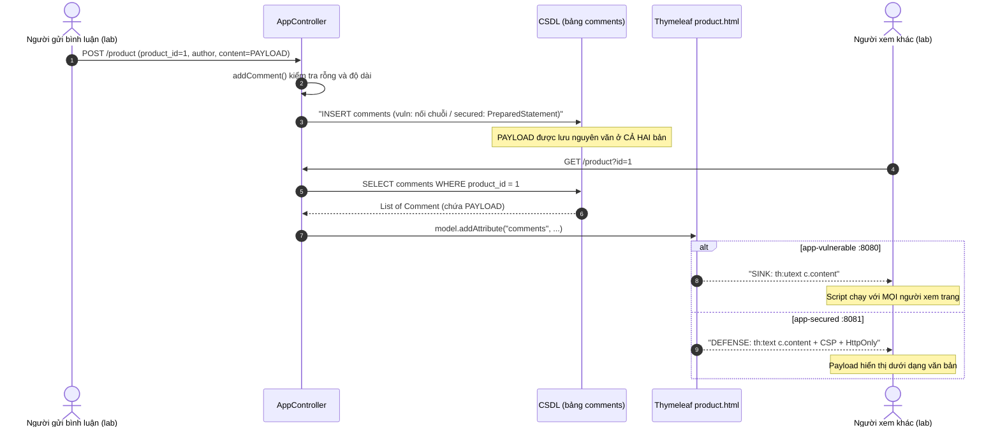

# TÀI LIỆU NGHIÊN CỨU TASK XSS-01 (ANM-38)
**Nghiên cứu Reflected và Stored XSS theo OWASP 2025**

| Thuộc tính | Chi tiết |
| :--- | :--- |
| **Mã nội bộ** | `XSS-01` (`ANM-38`) |
| **Phạm vi phụ trách** | TV2 - Hồng Sơn |
| **Ưu tiên kế hoạch** | Cao |
| **Phụ thuộc** | `ANM-17` (`CORE-01` - Dựng khung ứng dụng VulnerableApp và cấu hình ban đầu) |
| **Phiên bản mã nguồn khảo sát** | Nhánh `HongSon/CORE-07`, commit `00fd329` — Spring Boot `3.2.5`, Java `17`, Thymeleaf (qua `spring-boot-starter-thymeleaf`), MariaDB/H2 (`MODE=MySQL`) |
| **Phiên bản chuẩn tham chiếu** | OWASP Top 10:**2025** — hạng mục `A05:2025 Injection`; `CWE-79` |
| **Trạng thái** | **HOÀN THÀNH (DONE)** |

> **Theo dõi kế hoạch & Giới hạn an toàn:**
> - Sprint, điểm ước lượng và người được giao được quản lý trực tiếp bằng trường Jira; không sao chép số sprint hoặc điểm vào mô tả.
> - Chỉ thực hiện trên lab của nhóm (`localhost:8080`, `localhost:8081`) và bộ dữ liệu giả trong [`lab-environment/db/init.sql`](../../lab-environment/db/init.sql); tuyệt đối không thử nghiệm hệ thống bên ngoài và không thu thập tài khoản hay thông tin cá nhân thật.
> - Mọi payload trong tài liệu này là **vô hại**: chỉ gọi `console.log`, chèn thẻ hiển thị hoặc đổi giao diện cục bộ; **không** đọc `document.cookie`, **không** gửi dữ liệu ra ngoài.

---

## 1. Mục tiêu & Sản phẩm bàn giao

Nghiên cứu hai dạng Cross-Site Scripting (Reflected XSS và Stored XSS), xác định chính xác vị trí tương ứng trong hai ứng dụng của dự án và phân tích cách bảo vệ đầu ra (output encoding) cùng các lớp phòng vệ bổ sung.

| Hạng mục bàn giao | Tệp tin / Đường dẫn | Mô tả |
| :--- | :--- | :--- |
| **Tài liệu lý thuyết & sơ đồ luồng dữ liệu** | `docs/tasks/XSS-01_nghien_cuu_reflected_va_stored_xss_owasp_2025.md` (tài liệu này) | Lý thuyết, ánh xạ mã nguồn, 2 sơ đồ Mermaid, phân tích phòng vệ, thiết kế PoC, nguồn OWASP |
| **Bộ kiểm chứng PoC (Vulnerable)** | [`lab-environment/app-vulnerable/src/test/java/com/uth/websec/Xss01SafePocTest.java`](../../lab-environment/app-vulnerable/src/test/java/com/uth/websec/Xss01SafePocTest.java) | 5 ca kiểm thử (`XSS-01.1` → `XSS-01.5`) xác nhận điểm yếu |
| **Bộ kiểm chứng PoC (Secured)** | [`lab-environment/app-secured/src/test/java/com/uth/websec/Xss01SafePocTest.java`](../../lab-environment/app-secured/src/test/java/com/uth/websec/Xss01SafePocTest.java) | 5 ca kiểm thử tương ứng xác nhận lớp phòng vệ |
| **Nhật ký kiểm chứng** | [`docs/tasks/logs/xss-01_poc_verification.log`](./logs/xss-01_poc_verification.log) | Log chạy `mvn test` (5/5 mỗi bản, hồi quy 30/30 mỗi bản) |

> [!NOTE]
> Theo yêu cầu *"Có mã nguồn chưa đủ để kết luận"*, các nhận định về điểm yếu và phòng vệ trong tài liệu được kiểm chứng bằng bộ test tự động ở trên. MockMvc **không thực thi JavaScript**, nên bộ test kiểm chứng *điều kiện* thực thi (payload thô hay đã mã hóa trong HTML, header CSP, cờ HttpOnly). Việc script có thực sự chạy trên trình duyệt được kiểm tra thủ công theo [mục 6.5](#65-quy-trình-chạy-thủ-công-trên-trình-duyệt).

---

## 2. Cơ sở lý thuyết theo OWASP Top 10:2025

### 2.1. Vị trí của XSS trong OWASP Top 10:2025
- Trong OWASP Top 10:2025, Cross-Site Scripting **không còn là hạng mục riêng** mà thuộc **`A05:2025 Injection`** (Injection giảm từ hạng 3 năm 2021 xuống hạng 5).
- OWASP định nghĩa lỗ hổng Injection là khi *dữ liệu không tin cậy do người dùng cung cấp được gửi tới một trình thông dịch* (trình duyệt, CSDL, dòng lệnh) *và khiến trình thông dịch đó thực thi một phần dữ liệu như lệnh*. Với XSS, **trình thông dịch là trình duyệt** (HTML parser + JavaScript engine).
- Theo bảng số liệu của A05:2025, XSS có tần suất rất cao (hơn 30.000 CVE gắn với `CWE-79`) nhưng mức tác động trung bình thấp hơn SQL Injection.
- Mã định danh: **`CWE-79` — Improper Neutralization of Input During Web Page Generation ('Cross-site Scripting')**.

### 2.2. Ba khái niệm cốt lõi: Source, Sink, Context
| Khái niệm | Định nghĩa | Ví dụ trong dự án |
| :--- | :--- | :--- |
| **Source** | Nơi dữ liệu không tin cậy đi vào ứng dụng | Tham số `keyword` của `GET /search`; trường `content` của `POST /product` |
| **Sink** | Nơi dữ liệu được đưa vào trình thông dịch mà không được trung hòa | `th:utext="${keyword}"`, `th:utext="${c.content}"` |
| **Context** | Ngữ cảnh cú pháp tại vị trí chèn dữ liệu, quyết định cách mã hóa đúng | HTML Body (`<span>...</span>`), HTML Attribute (`value="..."`), JavaScript, URL |

### 2.3. Phân loại XSS
| Loại | Dữ liệu độc hại nằm ở đâu | Phạm vi trong lab |
| :--- | :--- | :--- |
| **Reflected XSS** | Trong chính request (URL/form), được server phản chiếu ngay vào response | **Có** — chức năng tìm kiếm |
| **Stored (Persistent) XSS** | Được lưu vào tầng lưu trữ (CSDL), sau đó hiển thị lại cho người xem | **Có** — chức năng bình luận |
| **DOM-based XSS** | Được JavaScript phía client đọc và ghi vào DOM, không qua server render | Ngoài phạm vi (ứng dụng không có JavaScript phía client xử lý input) |

---

## 3. Phân biệt Reflected và Stored XSS & Ánh xạ vào ứng dụng

### 3.1. Bảng so sánh bản chất

| Tiêu chí | Reflected XSS (dữ liệu phản chiếu trong phản hồi) | Stored XSS (dữ liệu lưu rồi hiển thị lại) |
| :--- | :--- | :--- |
| **Vòng đời dữ liệu** | Chỉ tồn tại trong **một cặp request/response** | Tồn tại **bền vững** trong CSDL cho đến khi bị xóa |
| **Đi qua tầng lưu trữ** | Không | Có (bảng `comments`) |
| **Cách nạn nhân bị ảnh hưởng** | Phải tự mở một URL/form đã được chế tạo sẵn | Chỉ cần xem trang bình thường |
| **Phạm vi nạn nhân** | Từng người mở liên kết | **Mọi người** truy cập trang chứa dữ liệu |
| **Dấu vết phía server** | Chỉ trong access log / log ứng dụng | Có bản ghi trong CSDL |
| **Mức độ nguy hiểm** | Trung bình (cần lừa người dùng) | Cao hơn (tự lan truyền, tồn tại lâu) |
| **Kiểm chứng trong dự án** | `XSS-01.1`, `XSS-01.2` | `XSS-01.3` |

Test `XSS-01.2` xác nhận đặc điểm "không lưu" của Reflected XSS: sau khi gửi payload qua `/search`, bảng `comments` không có bản ghi nào chứa payload và request tìm kiếm kế tiếp không còn payload. Test `XSS-01.3` xác nhận đặc điểm "lưu rồi hiển thị lại": payload được ghi vào `comments` và **hai lần tải trang độc lập** (mô phỏng hai người xem) đều nhận lại payload.

### 3.2. Ánh xạ Reflected XSS — Chức năng tìm kiếm (`CORE-04`)

| Lớp | `app-vulnerable` (`:8080`) | `app-secured` (`:8081`) |
| :--- | :--- | :--- |
| **Source** | [`AppController.search()` L157-167](../../lab-environment/app-vulnerable/src/main/java/com/uth/websec/controller/AppController.java#L157-L167): `@RequestParam("keyword")` → `model.addAttribute("keyword", displayKeyword)` (chuỗi thô) | [`AppController.search()` L162-172](../../lab-environment/app-secured/src/main/java/com/uth/websec/controller/AppController.java#L162-L172): `keyword.trim()` → `model.addAttribute("keyword", cleanKeyword)` (chỉ cắt khoảng trắng) |
| **Sink / Defense Point** (HTML Body) | [`search.html` L192](../../lab-environment/app-vulnerable/src/main/resources/templates/search.html#L192): `<span th:utext="${keyword}"></span>` ❌ | [`search.html` L187](../../lab-environment/app-secured/src/main/resources/templates/search.html#L187): `<span th:text="${keyword}"></span>` ✅ |

> [!NOTE]
> Ở bản vulnerable, `keyword` **đồng thời** được nối vào câu SQL `LIKE '%" + keyword + "%'` ([L199](../../lab-environment/app-vulnerable/src/main/java/com/uth/websec/controller/AppController.java#L199)). Vì vậy payload XSS minh họa **không chứa dấu nháy đơn `'`** để tránh lỗi SQL và tách bạch kết quả XSS với SQLi.

### 3.3. Ánh xạ Stored XSS — Chức năng bình luận (`CORE-06`)

| Lớp | `app-vulnerable` (`:8080`) | `app-secured` (`:8081`) |
| :--- | :--- | :--- |
| **Source** (form) | [`product.html` L331-342](../../lab-environment/app-vulnerable/src/main/resources/templates/product.html#L331-L342): `author`, `content` → `POST /product` | Tương tự ([`product.html` L330-341](../../lab-environment/app-secured/src/main/resources/templates/product.html#L330-L341)) |
| **Kiểm tra đầu vào** | [`AppController.addComment()` L320-339](../../lab-environment/app-vulnerable/src/main/java/com/uth/websec/controller/AppController.java#L320-L339): rỗng, `author > 50`, `content > 1000` ký tự | [`AppController.addComment()` L339-371](../../lab-environment/app-secured/src/main/java/com/uth/websec/controller/AppController.java#L339-L371): như bên trái + ép `product_id` về số nguyên dương. **Không lọc HTML** |
| **Persist** (`comments`) | [L345-347](../../lab-environment/app-vulnerable/src/main/java/com/uth/websec/controller/AppController.java#L345-L347): `Statement` nối chuỗi `INSERT` — lưu nguyên văn | [L374-381](../../lab-environment/app-secured/src/main/java/com/uth/websec/controller/AppController.java#L374-L381): `PreparedStatement` — chặn SQLi nhưng **vẫn lưu nguyên văn HTML/JS** |
| **Load** | `SELECT * FROM comments WHERE product_id = ...` trong `productDetail()` | `PreparedStatement` tương ứng |
| **Sink / Defense Point** (HTML Body) | [`product.html` L352](../../lab-environment/app-vulnerable/src/main/resources/templates/product.html#L352): `<div class="comment-body" th:utext="${c.content}">` ❌ | [`product.html` L351](../../lab-environment/app-secured/src/main/resources/templates/product.html#L351): `<div class="comment-body" th:text="${c.content}">` ✅ |

> [!IMPORTANT]
> Bản secured hiện **chưa có bước lọc HTML đầu vào** (thuộc phạm vi task `XSS-08`). Test `XSS-01.3` (secured) xác nhận payload **vẫn nằm nguyên văn trong CSDL**; việc chặn XSS hoàn toàn diễn ra **ở đầu ra** (`th:text`) cùng hai lớp bổ sung CSP và HttpOnly.

### 3.4. Các vị trí đã kiểm tra và xác định không khai thác được

| Vị trí | Lý do an toàn |
| :--- | :--- |
| Ô nhập tìm kiếm `th:value="${keyword}"` (`search.html` L186 / L181) | Thymeleaf tự mã hóa giá trị thuộc tính (`"` → `&quot;`) nên không thoát được khỏi thuộc tính `value` |
| Thông báo không có kết quả `th:text="${keyword}"` (`search.html` L221 / L213) | Đã mã hóa HTML |
| Tên tác giả bình luận `th:text="${c.author}"` (`product.html` L348 / L347) | Đã mã hóa HTML |
| Khối thông báo dịch vụ `systemAlerts` — `th:text="${error}"` ([`layout.html` L246](../../lab-environment/app-vulnerable/src/main/resources/templates/fragments/layout.html#L246)) | Đã mã hóa HTML |
| Trang lỗi 404 bản vulnerable — `errorMessage` chứa `request.getRequestURI()` ([`GlobalControllerAdvice` L45](../../lab-environment/app-vulnerable/src/main/java/com/uth/websec/controller/GlobalControllerAdvice.java#L45)) | Hiển thị bằng `th:text` trong [`error.html` L108](../../lab-environment/app-vulnerable/src/main/resources/templates/error.html#L108) nên không thực thi |

---

## 4. Sơ đồ luồng dữ liệu (Data Flow Diagrams)

### 4.1. Reflected XSS — `GET /search`

```mermaid
sequenceDiagram
    autonumber
    actor U as Trình duyệt (người dùng lab)
    participant C as AppController.search()
    participant DB as CSDL (bảng products)
    participant T as Thymeleaf search.html
    U->>C: GET /search?keyword=PAYLOAD
    C->>DB: Truy vấn sản phẩm theo keyword
    DB-->>C: Danh sách sản phẩm (0 kết quả)
    C->>T: model.addAttribute("keyword", PAYLOAD)
    alt app-vulnerable :8080
        T-->>U: "SINK: th:utext chèn PAYLOAD nguyên văn vào HTML"
        Note over U: Không có CSP - trình duyệt thực thi script
    else app-secured :8081
        T-->>U: "DEFENSE 1: th:text trả về &lt;script&gt;..."
        Note over U: "DEFENSE 2: CSP default-src 'self' chặn inline script"
    end
    Note over C,DB: PAYLOAD không được lưu - vòng đời kết thúc khi response trả về
```

### 4.2. Stored XSS — `POST /product` rồi `GET /product?id=1`



---

## 5. Phòng vệ nhiều lớp (Defense in Depth)

### 5.1. Mã hóa đầu ra theo ngữ cảnh (Context-Aware Output Encoding) — lớp cốt lõi

**Vì sao phải theo ngữ cảnh:** cùng một ký tự có ý nghĩa khác nhau tùy vị trí chèn. `<` nguy hiểm trong HTML Body nhưng vô hại trong chuỗi JavaScript; ngược lại `"` và `\` lại là ký tự thoát khỏi chuỗi JavaScript. Mã hóa sai ngữ cảnh vẫn có thể bị khai thác.

| Ngữ cảnh | Ví dụ vị trí | Cách mã hóa đúng | Cú pháp Thymeleaf an toàn |
| :--- | :--- | :--- | :--- |
| **HTML Body** | `<span>DATA</span>` | HTML entity encoding `< > & " '` | `th:text="${data}"` |
| **HTML Attribute** (có dấu nháy) | `<input value="DATA">` | HTML attribute encoding | `th:value`, `th:attr` |
| **JavaScript** | `<script>var x = 'DATA';</script>` | JavaScript string escaping (`\x..`, `\u....`) | `th:inline="javascript"` + `[[${data}]]` |
| **URL / tham số URL** | `<a href="/search?keyword=DATA">` | Percent-encoding | `th:href="@{/search(keyword=${data})}"` |
| **CSS** | `style="color: DATA"` | CSS escaping / không đưa dữ liệu người dùng vào CSS | Tránh hoàn toàn |

> [!WARNING]
> `th:text` **chỉ an toàn cho ngữ cảnh HTML Body**. Không được dùng `th:text` để đưa dữ liệu vào trong thẻ `<script>`, thuộc tính sự kiện (`onclick`) hay `href="javascript:..."`.

**So sánh `th:utext` và `th:text` (đã kiểm chứng bằng `XSS-01.1`, `XSS-01.3`):**

| | `th:utext` (Unescaped Text — bản vulnerable) | `th:text` (Escaped Text — bản secured) |
| :--- | :--- | :--- |
| Hành vi | Ghi chuỗi **nguyên văn** vào HTML | Mã hóa ký tự đặc biệt thành HTML entities rồi mới ghi |
| HTML nhận được với R1 | `<script>console.log("XSS-01 R1 reflected")</script>` | `&lt;script&gt;console.log(&quot;XSS-01 R1 reflected&quot;)&lt;/script&gt;` |
| Trình duyệt hiểu là | Thẻ `<script>` → thực thi | Văn bản → hiển thị |

**Bảng chuyển đổi ký tự của `th:text`:**

| Ký tự | `<` | `>` | `&` | `"` | `'` |
| :--- | :---: | :---: | :---: | :---: | :---: |
| HTML entity | `&lt;` | `&gt;` | `&amp;` | `&quot;` | `&#39;` |

### 5.2. Kiểm tra dữ liệu nhập (Input Validation / Sanitization)

| Kỹ thuật | Vai trò | Hiện trạng trong dự án |
| :--- | :--- | :--- |
| **Kiểm tra độ dài** | Giảm bề mặt tấn công, chặn payload dài | Có ở cả 2 bản: `author ≤ 50`, `content ≤ 1000` |
| **Kiểm tra kiểu dữ liệu** | Đảm bảo tham số đúng kiểu | Secured ép `product_id` về `int > 0`; vulnerable thì không |
| **Allow-list** | Chỉ chấp nhận tập ký tự / định dạng cho phép (ví dụ mã sản phẩm chỉ là số) | Áp dụng cho `product_id` ở bản secured |
| **Sanitization HTML** | Loại bỏ thẻ/thuộc tính nguy hiểm khi bắt buộc phải cho phép một phần HTML (ví dụ OWASP Java HTML Sanitizer) | **Chưa có** (phạm vi `XSS-08`) |

**Vì sao Input Validation không thay thế được Output Encoding:**
1. Bình luận là **văn bản tự do**; không thể cấm `<`, `>`, `"` mà không làm hỏng nội dung hợp lệ (ví dụ "giá < 30 triệu").
2. Bộ lọc dạng block-list (cấm `<script>`) dễ bị vượt qua bằng các vector khác như ``, `<svg onload>` (xem payload R3, S3, S4).
3. Kiểm tra đầu vào **không biết** dữ liệu sẽ được hiển thị ở ngữ cảnh nào. Chỉ đầu ra mới biết ngữ cảnh để mã hóa đúng.
4. Dữ liệu có thể vào CSDL qua nhiều đường khác (import, công cụ quản trị, bản ghi cũ). Bằng chứng: bản secured vẫn lưu nguyên văn payload (`XSS-01.3`) nhưng không bị khai thác nhờ mã hóa đầu ra.

→ **Kết luận:** Input Validation là lớp **hỗ trợ**; Output Encoding theo ngữ cảnh là lớp **bắt buộc**.

### 5.3. Cờ `HttpOnly` của cookie — lớp giảm thiểu hậu quả

| Thuộc tính | `app-vulnerable` ([L102-111](../../lab-environment/app-vulnerable/src/main/java/com/uth/websec/controller/AppController.java#L102-L111)) | `app-secured` ([L101-113](../../lab-environment/app-secured/src/main/java/com/uth/websec/controller/AppController.java#L101-L113)) |
| :--- | :--- | :--- |
| Cookie phiên nghiệp vụ | `session_token` = Base64(`username` + hậu tố cố định) | `session_token` |
| `HttpOnly` | `false` ❌ (`XSS-01.5`) | `true` ✅ (`XSS-01.5`) |
| `SameSite` | Không đặt | `Strict` |
| `Secure` | Không đặt | `false` (lab chạy HTTP; cần bật khi dùng HTTPS) |

**Cơ chế:** cookie có cờ `HttpOnly` vẫn được trình duyệt gửi kèm request nhưng **không thể đọc qua `document.cookie`**. Nếu ứng dụng vẫn còn sót một lỗi XSS, kẻ tấn công không lấy được giá trị phiên để chiếm phiên từ máy khác.

**Giới hạn:** `HttpOnly` **không ngăn XSS**. Script độc hại vẫn chạy và vẫn có thể thao tác trang hoặc gửi request dưới danh nghĩa nạn nhân ngay trong trình duyệt đó.

### 5.4. Content-Security-Policy (CSP) — chốt chặn phía trình duyệt

Header hiện tại của bản secured ([`SecurityHeadersFilter.java` L24](../../lab-environment/app-secured/src/main/java/com/uth/websec/filter/SecurityHeadersFilter.java#L24), kiểm chứng `XSS-01.4`):

```http
Content-Security-Policy: default-src 'self'; style-src 'self' 'unsafe-inline';
X-Content-Type-Options: nosniff
X-Frame-Options: DENY
```

| Chỉ thị | Ý nghĩa |
| :--- | :--- |
| `default-src 'self'` | Không khai báo `script-src` nên trình duyệt dùng `default-src`. Chỉ cho phép script từ cùng origin và **chặn inline `<script>` cũng như inline event handler** (`onerror=`, `onload=`) |
| `style-src 'self' 'unsafe-inline'` | Cho phép CSS inline (layout hiện tại dùng thẻ `<style>`). Đây là sự đánh đổi: vẫn còn rủi ro CSS injection mức thấp |

**Vai trò:** CSP là lớp **giảm thiểu (mitigation)**. Nếu một lỗi chèn HTML lọt qua lớp mã hóa đầu ra, trình duyệt vẫn từ chối chạy script inline. Bản vulnerable **không** gửi header này (`XSS-01.4`).

**Khuyến nghị bổ sung** (chỉ ghi nhận, không thay đổi mã trong task này): thêm `object-src 'none'`, `base-uri 'self'`, `frame-ancestors 'none'`. Về lâu dài nên chuyển CSS inline ra tệp tĩnh để bỏ `'unsafe-inline'`.

### 5.5. Tổng hợp các lớp phòng vệ

| Lớp | Loại | `app-vulnerable` | `app-secured` | Bằng chứng |
| :--- | :--- | :---: | :---: | :--- |
| Output Encoding (`th:text`) tại sink tìm kiếm | Ngăn chặn | ❌ | ✅ | `XSS-01.1` |
| Output Encoding (`th:text`) tại sink bình luận | Ngăn chặn | ❌ | ✅ | `XSS-01.3` |
| Kiểm tra độ dài đầu vào | Hỗ trợ | ✅ | ✅ | `Core06ProductDetailAndCommentTest` |
| Sanitization HTML đầu vào | Hỗ trợ | ❌ | ❌ (phạm vi `XSS-08`) | `XSS-01.3` (CSDL giữ nguyên văn) |
| CSP | Giảm thiểu | ❌ | ✅ | `XSS-01.4` |
| `HttpOnly` cookie phiên | Giảm thiểu | ❌ | ✅ | `XSS-01.5` |

---

## 6. Thiết kế minh họa JavaScript vô hại (Safe PoC Design)

### 6.1. Nguyên tắc an toàn
1. Chỉ chạy trên `http://localhost:8080` và `http://localhost:8081` của nhóm.
2. Chỉ dùng dữ liệu seed giả trong `init.sql` (tài khoản `nguyenvana` / `pass123456`, sản phẩm `id=1`, `id=3`).
3. Payload **chỉ** gọi `console.log`, chèn thẻ hiển thị hoặc đổi giao diện cục bộ. **Không** đọc `document.cookie`, **không** dùng `fetch`/`Image`/`XMLHttpRequest` gửi dữ liệu đi, **không** chuyển hướng trang.
4. Payload không chứa dấu nháy đơn `'` (xem ghi chú mục 3.2).
5. Dọn dữ liệu sau khi chạy Stored PoC bằng [`scripts/reset_db.ps1`](../../scripts/reset_db.ps1) hoặc [`scripts/reset_db.sh`](../../scripts/reset_db.sh).

> [!CAUTION]
> Các tệp có sẵn `exploits/xss/reflected_xss_payload.html` và `exploits/xss/stored_xss_comment.txt` thuộc phạm vi task `XSS-04`/`XSS-05` và **có chứa** payload đọc `document.cookie` rồi gửi về cổng `8888`. Tài liệu XSS-01 **không sử dụng** các payload đó.

### 6.2. Bộ payload Reflected (qua `GET /search?keyword=...`)

| ID | Vector | Payload | Kết quả kỳ vọng `:8080` | Kết quả kỳ vọng `:8081` |
| :--- | :--- | :--- | :--- | :--- |
| **R1** | `<script>` | `<script>console.log("XSS-01 R1 reflected")</script>` | Console in `XSS-01 R1 reflected` | Hiển thị nguyên chuỗi dạng chữ; View Source thấy `&lt;script&gt;` |
| **R2** | Chèn HTML, không có JS | `<mark id="xss01-r2">XSS-01 R2 HTML injection</mark>` | Chữ được tô nền vàng (thẻ được dựng) | Hiển thị nguyên văn thẻ `<mark ...>` |
| **R3** | Event handler | `` | Console in tiêu đề trang | Hiển thị dạng chữ |
| **R4** | Chèn banner DOM | `<script>document.body.insertAdjacentHTML("afterbegin","<p id=xss01-r4>XSS-01 R4 - LAB DEMO</p>")</script>` | Dòng `XSS-01 R4 - LAB DEMO` xuất hiện đầu trang | Hiển thị dạng chữ |

URL mẫu (trình duyệt tự percent-encode khi dán):
```text
http://localhost:8080/search?keyword=<script>console.log("XSS-01 R1 reflected")</script>
http://localhost:8081/search?keyword=<script>console.log("XSS-01 R1 reflected")</script>
```

### 6.3. Bộ payload Stored (nhập vào ô "Nội dung bình luận" tại `/product?id=1`)

| ID | Vector | Payload | Kết quả kỳ vọng `:8080` | Kết quả kỳ vọng `:8081` |
| :--- | :--- | :--- | :--- | :--- |
| **S1** | `<script>` | `<script>console.log("XSS-01 S1 stored")</script>` | **Mọi lần** tải `/product?id=1` (bất kỳ người xem nào) đều in log | Bình luận hiển thị dạng chữ |
| **S2** | Chèn HTML | `<mark>XSS-01 S2 stored HTML</mark>` | Bình luận có nền vàng | Hiển thị nguyên văn thẻ |
| **S3** | Event handler | `` | Console in `/product` | Hiển thị dạng chữ |
| **S4** | Đổi giao diện | `<svg onload="document.body.style.outline=&quot;4px dashed orange&quot;"></svg>` | Viền cam nét đứt quanh trang | Hiển thị dạng chữ |

### 6.4. Kết quả kiểm chứng tự động

Chi tiết tại [`docs/tasks/logs/xss-01_poc_verification.log`](./logs/xss-01_poc_verification.log).

| Mã test | Nội dung kiểm chứng | `app-vulnerable` | `app-secured` |
| :---: | :--- | :--- | :--- |
| **`XSS-01.1`** | Reflected R1, R3 trong HTML `/search` | Payload **nguyên văn** — **PASS** | Payload **đã mã hóa**, không còn thẻ thô — **PASS** |
| **`XSS-01.2`** | Reflected không được lưu, không xuất hiện ở request sau | **PASS** | **PASS** |
| **`XSS-01.3`** | Stored S1, S2: lưu CSDL và hiển thị qua 2 lần tải trang | Lưu nguyên văn, hiển thị **thô** — **PASS** | Lưu nguyên văn, hiển thị **đã mã hóa** — **PASS** |
| **`XSS-01.4`** | Header CSP | Không có — **PASS** | `default-src 'self'; ...` — **PASS** |
| **`XSS-01.5`** | Cờ `HttpOnly` của `session_token` | Không có — **PASS** | `HttpOnly; SameSite=Strict` — **PASS** |

Hồi quy toàn bộ: `app-vulnerable` **30/30**, `app-secured` **30/30** (`BUILD SUCCESS`).

### 6.5. Quy trình chạy thủ công trên trình duyệt

1. Khởi động lab: `docker compose up -d`.
2. **Reflected:** mở URL R1 ở mục 6.2 trên cả hai cổng, mở DevTools → tab **Console**.
   - `:8080`: thấy dòng `XSS-01 R1 reflected`.
   - `:8081`: không có log; giao diện hiển thị nguyên chuỗi payload; **View Source** (`Ctrl+U`) thấy `&lt;script&gt;`.
3. **Stored:** tại `/product?id=1`, gửi S1 làm nội dung bình luận, sau đó mở trang này trong một **cửa sổ ẩn danh** (người xem khác) và quan sát Console như bước 2.
4. **Tách riêng tác dụng CSP:** ở bước 2, **View Source** trên `:8081` cho thấy lớp mã hóa đầu ra đã chặn trước. Header CSP xem tại tab **Network** → request `/search` → **Response Headers**.
5. **HttpOnly** (không dùng payload): đăng nhập `nguyenvana` / `pass123456`, gõ `document.cookie` trong Console.
   - `:8080`: thấy `session_token=...`.
   - `:8081`: không thấy `session_token` (tab **Application → Cookies** hiển thị dấu ✓ ở cột `HttpOnly`).
6. Dọn dữ liệu: `powershell -ExecutionPolicy Bypass -File scripts/reset_db.ps1`.

---

## 7. Nguồn tham chiếu

| # | Nguồn | Phiên bản / Đường dẫn |
| :---: | :--- | :--- |
| 1 | OWASP Top 10:2025 — A05:2025 Injection | https://owasp.org/Top10/2025/A05_2025-Injection/ |
| 2 | OWASP Top 10:2025 — Trang tổng quan | https://owasp.org/Top10/2025/ |
| 3 | OWASP Cross Site Scripting Prevention Cheat Sheet | https://cheatsheetseries.owasp.org/cheatsheets/Cross_Site_Scripting_Prevention_Cheat_Sheet.html |
| 4 | OWASP Content Security Policy Cheat Sheet | https://cheatsheetseries.owasp.org/cheatsheets/Content_Security_Policy_Cheat_Sheet.html |
| 5 | OWASP Web Security Testing Guide — Testing for Reflected XSS (`WSTG-INPV-01`), Stored XSS (`WSTG-INPV-02`) | https://owasp.org/www-project-web-security-testing-guide/ |
| 6 | MITRE CWE-79: Improper Neutralization of Input During Web Page Generation | https://cwe.mitre.org/data/definitions/79.html |
| 7 | Thymeleaf — Using Thymeleaf (`th:text` / `th:utext`, inlining JavaScript) | https://www.thymeleaf.org/doc/tutorials/3.1/usingthymeleaf.html |
| 8 | MDN — Content-Security-Policy; Set-Cookie (`HttpOnly`, `SameSite`) | https://developer.mozilla.org/docs/Web/HTTP/Headers/Content-Security-Policy |

**Giới hạn của tài liệu:**
- Chỉ phân tích hai sink trong phạm vi ứng dụng lab; không đánh giá DOM-based XSS hay các thư viện bên thứ ba.
- Bộ test MockMvc kiểm chứng phản hồi HTML và header, **không** chạy JavaScript; hành vi trình duyệt được mô tả là *kết quả kỳ vọng* và kiểm tra thủ công theo mục 6.5.
- Nhận định về CSP dựa trên đặc tả CSP Level 3 của các trình duyệt hiện đại (Chrome/Edge/Firefox); trình duyệt cũ có thể hành xử khác.
- Lab chạy HTTP nên cờ `Secure` đang tắt; không phản ánh cấu hình triển khai thật.

---

## 8. Checklist nghiệm thu XSS-01

| # | Tiêu chí hoàn thành (Jira `ANM-38`) | Mục đáp ứng | Bằng chứng | Kết quả |
| :---: | :--- | :--- | :--- | :---: |
| 1a | Phân biệt dữ liệu phản chiếu trong phản hồi với dữ liệu lưu rồi hiển thị lại | §2.3, §3.1 | `XSS-01.2` (không lưu), `XSS-01.3` (lưu và hiển thị qua 2 lần tải) | ✅ |
| 1b | Xác định điểm tương ứng trong ứng dụng | §3.2, §3.3, §3.4, §4 | Liên kết tới file/dòng; `XSS-01.1`, `XSS-01.3` | ✅ |
| 2a | Giải thích mã hóa đầu ra theo ngữ cảnh | §5.1 | So sánh `th:utext`/`th:text` được kiểm chứng ở `XSS-01.1`, `XSS-01.3` | ✅ |
| 2b | Giải thích kiểm tra dữ liệu nhập | §5.2 | Phân tích hiện trạng; CSDL secured vẫn lưu nguyên văn (`XSS-01.3`) | ✅ |
| 2c | Vai trò bổ sung của CSP / HttpOnly | §5.3, §5.4, §5.5 | `XSS-01.4`, `XSS-01.5` | ✅ |
| 3a | Ghi phiên bản | Bảng thông tin đầu tài liệu | Nhánh + commit + Spring Boot/Java; OWASP Top 10:2025 | ✅ |
| 3b | Ghi nguồn OWASP | §2.1, §7 | A05:2025, XSS Prevention Cheat Sheet, WSTG, CWE-79 | ✅ |
| 3c | Ghi giới hạn | Khung giới hạn đầu tài liệu, §6.1, §7 | — | ✅ |
| 3d | Thiết kế minh họa JavaScript vô hại trên dữ liệu giả | §6.1 → §6.5 | 8 payload R1–R4, S1–S4; log [`xss-01_poc_verification.log`](./logs/xss-01_poc_verification.log) | ✅ |
